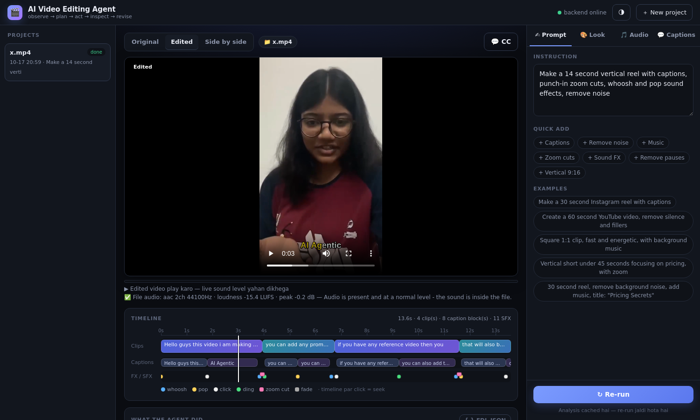
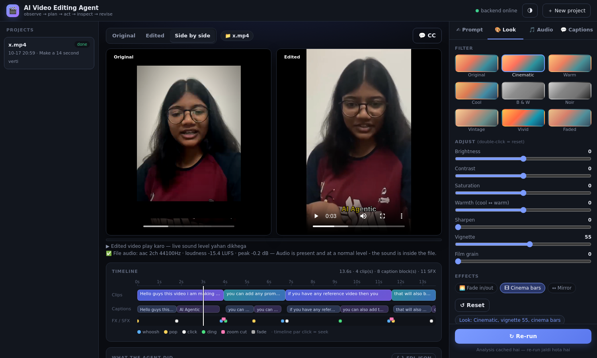
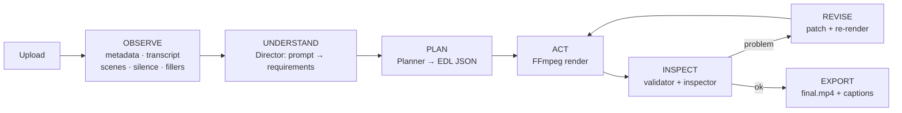

# 🎬 AI Video Editing Agent

Upload a talking-style video, type what you want in plain language, and get the edited video back.
The agent **watches** the video, **plans** the cuts, **renders** it, **checks its own output** and **repairs** it if something is wrong. You never touch a timeline.

> *"Make a 30 second vertical reel with captions and calm background music, remove pauses and mistakes."*

   



---

## ✨ Features

**Understands your prompt**
- Length and time windows: `10 seconds`, `0:00–0:15`, `first 20 seconds`, `1:05 to 1:35`
- Formats: vertical 9:16, square 1:1, 16:9
- Captions, zoom cuts, sound effects, noise removal, music, filters, brightness and more
- Your own caption script: lines like `00:03 – 00:07: "text"` are used exactly as written

**Edits like an editor (the agent "brain")**
- Cuts long pauses (also pauses hidden by background noise), stutters, false starts, and **re-takes**
- Hits the length you ask for (a 10 s request gives about 10 s), ending on a clean word
- *Enhance-only* prompts ("remove noise", "add music", "make it black and white") never delete a frame
- Every cut is explained with a reason and a timestamp

**Audio**
- Background noise removal (audio only, the timeline stays the same)
- Built-in royalty-free music (calm / neutral / upbeat), or upload your own track; the music dips automatically while someone speaks
- Whoosh, pop, click and ding sound effects on cuts and captions
- Quiet recordings are lifted towards a standard loudness

**Captions**
- Word-level Whisper transcript, animated captions with a highlighted word
- Fix a wrong line in the UI, then **Save & re-run**; SRT and VTT download

**Look & Effects**
- 9 filters: Cinematic, Warm, Cool, B&W, Noir, Vintage, Vivid, Faded
- Sliders: brightness, contrast, saturation, warmth, sharpen, vignette, film grain
- Fade in/out, cinema bars, mirror; live preview before you render

**Reliable**
- The plan is saved as readable JSON (an *Edit Decision List*); the original video is never changed
- The result is validated and inspected; a broken part is patched and re-rendered (max 3 tries, 4 fallback levels)
- Runs fully on your machine: no cloud, no paid API key



---

## 🧠 How it works



Every stage writes its result into the job folder (`jobs/<id>/`), so any decision can be opened and checked later. See [docs/ARCHITECTURE.md](docs/ARCHITECTURE.md) for details.

---

## 🚀 Quick start

**Requirements:** Python 3.10+ and **FFmpeg + ffprobe** available on your `PATH`.

```bash
# Linux / macOS
./run.sh

# Windows
run.bat          # or:  .\run.ps1
```

Open **http://localhost:8000**. The frontend is served by the same FastAPI app.

The Whisper model downloads on first use. Without a transcriber the agent still works (it plans from speech/silence regions only, without caption text).

### Use it
1. Drop a video on the page.
2. Write an instruction in the **Prompt** tab (or use the quick-add chips).
3. Optionally choose a **Look**, add **music**, or fix the **captions**.
4. Press **Edit video**. Use **Re-run** to change the instruction or look without re-analysing.

### Prompt examples
```text
Make a 45 second reel with captions and music
YouTube version, 1 minute, remove silence and fillers
Trim the video to 10 seconds
Remove the background noise and disturbance
Make it black and white with a vignette and fade in and out
Vertical 9:16 with zoom cuts and whoosh sound effects, calm background music
```

---

## ⚙️ Configuration

Set as environment variables.

| Variable | Default | Meaning |
|---|---|---|
| `WHISPER_MODEL` | `small` | `tiny`, `base`, `small`, `medium`, `large-v3` (bigger = more accurate, slower) |
| `WHISPER_LANGUAGE` | auto | Language hint, e.g. `en`, `hi` (use `hi` for Hindi / Hinglish speakers) |
| `WHISPER_PROMPT` | Hinglish sentence | Text that guides spelling style |
| `WHISPER_BEAM` | `5` | Beam size |
| `TRANSCRIBER` | `auto` | `auto`, `faster-whisper`, `whisper`, `none` |
| `SILENCE_DB` / `SILENCE_MIN` | `-35` / `0.5` | Silence threshold (dB) and minimum length (s) |
| `SCENE_THRESHOLD` | `27.0` | Scene-change sensitivity |
| `MAX_RETRIES` | `3` | Repair attempts before a job is marked failed |
| `LLM_PROVIDER` | `none` | `none` (rules only), `ollama`, `anthropic` |
| `OLLAMA_URL` / `OLLAMA_MODEL` | `http://localhost:11434` / `llama3.1` | Local LLM settings |
| `ANTHROPIC_API_KEY` / `ANTHROPIC_MODEL` | – | Needed only if `LLM_PROVIDER=anthropic` |
| `JOBS_DIR` | `./jobs` | Where jobs are stored |
| `MUSIC_DIR` | `./assets/music` | Drop your own mp3 here |

---

## 🔌 API

| Method | Path | Purpose |
|---|---|---|
| `POST` | `/api/jobs` | Upload a video (+ optional `instruction`, `music`, `look`) |
| `GET` | `/api/jobs`, `/api/jobs/{id}` | List jobs / job status |
| `POST` | `/api/jobs/{id}/edit` | Run an instruction (`retranscribe` optional) |
| `GET` | `/api/jobs/{id}/analysis` | Metadata, transcript, scenes, silences, fillers |
| `GET` | `/api/jobs/{id}/edl`, `/edl/preview` | The plan (JSON / readable) |
| `PUT` `GET` | `/api/jobs/{id}/look` | Save / read look & effects |
| `POST` `DELETE` | `/api/jobs/{id}/music` | Upload / remove background music |
| `PUT` | `/api/jobs/{id}/transcript` | Save corrected captions |
| `GET` | `/api/jobs/{id}/video?kind=source\|draft\|final` | Stream video (Range supported) |
| `GET` | `/api/jobs/{id}/audio-check` | Does the file have audible sound, and how loud |
| `GET` | `/api/jobs/{id}/captions`, `/captions/download` | VTT / SRT |
| `GET` | `/api/jobs/{id}/download`, `/log`, `/api/health` | Download, log, health |

---

## 📁 Project structure

```text
backend/app/
├── main.py                  FastAPI app and routes
├── config.py                settings (environment variables)
├── agents/
│   ├── director.py          prompt → requirements (rules, optional LLM)
│   ├── planner.py           segments → EDL (selection, exact length, brain cuts)
│   ├── validator.py         checks / patches the plan
│   ├── inspector.py         checks the rendered file
│   └── loop.py              observe → … → export, retry loop
├── analysis/
│   ├── metadata.py  transcription.py  scenes.py  silence.py  fillers.py
│   ├── fumbles.py           pauses, stutters, false starts, retakes
│   └── pipeline.py          runs and caches the analysis
├── editing/
│   ├── renderer.py          EDL → FFmpeg (3 passes, fallback levels)
│   ├── captions.py          captions, ASS/SRT/VTT
│   ├── denoise.py           spectral noise removal
│   ├── music.py             built-in music generator
│   └── look.py              filters, colour, effects
├── models/                  Pydantic models (EDL, transcript, analysis…)
├── services/jobs.py         job folders and state
└── utils/ffmpeg.py
backend/tests/               pytest suite
frontend/index.html          single-page studio UI
docs/                        architecture, sample EDL, changelog
```

---

## 🧪 Tests

```bash
cd backend
pip install -r requirements.txt
pytest -q
```

Uses synthetic test videos; no Whisper model is needed. Coverage includes the pipeline, exact-length trimming, noise removal quality, music level, the agent brain, every look control (checked by measuring pixels), and the API.

---

## 📌 Project status

| Area | Status |
|---|---|
| Upload, job folders, metadata | ✅ |
| Transcript, scenes, silence, fillers | ✅ |
| Director, Planner, EDL schema | ✅ |
| Renderer: cuts, aspect ratio, zoom, fades, captions, titles | ✅ |
| Validator, Inspector, revise loop, fallback levels | ✅ |
| Agent brain (pauses, stutters, retakes), exact length | ✅ |
| Noise removal, music, sound effects, loudness | ✅ |
| Look & Effects, studio UI, caption editor, sound check | ✅ |
| Measuring Hinglish caption accuracy with real Whisper on more videos | ⏳ |
| Reference-video style matching | ⏳ not started |
| Face-aware reframing (currently centre crop) | ⏳ |
| Upload file-type / size limits | ⏳ |
| LLM director tested end to end | ⏳ |

---

## 👩‍💻 Team

B.Tech Major Project, Institute of Engineering and Technology (IET), JK Lakshmipat University.

**Kalpana Baghel · Riddhi Khandelwal · Tanishka Nagal**